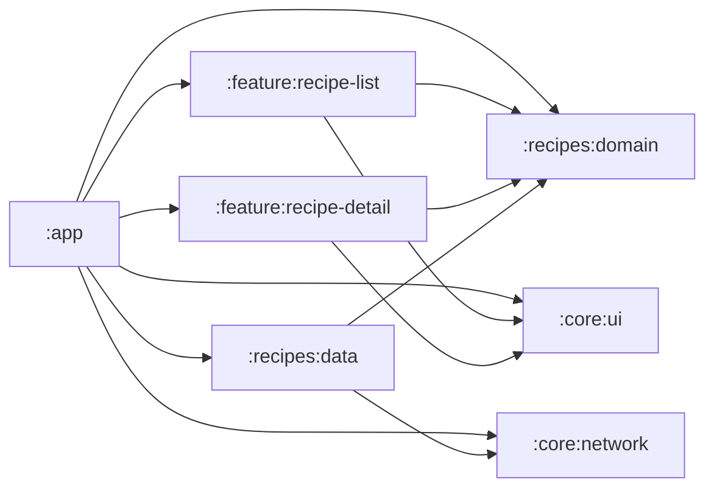
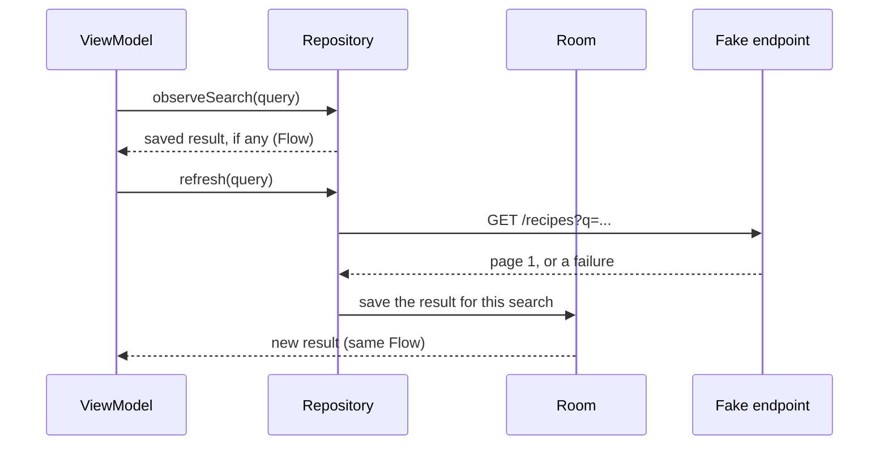

# Recipes Android

A native Android app to browse, search and filter recipes. It works offline: the screens show what was saved on the device, and each call to the server updates it. Kotlin, Jetpack Compose, Material 3.

There is no real server. A JSON file in the app plays the HTTP endpoint, behind a real Retrofit and OkHttp client.

| List | Detail | Filters | Offline |
| :---: | :---: | :---: | :---: |
|  |  |  |  |

What you can do:

- Scroll the recipe list. More recipes load at the end of the list. Pull to refresh.
- Search by title or description. Accents and case don't matter.
- Filter by diet, servings and difficulty. Pick ingredients a recipe must have or must not have. Search the instructions.
- Open a recipe: stats, ingredients scaled to the number of servings you pick, and the steps.

## Run it

You need Android Studio with the Android SDK, a JDK 17 for Gradle, and an emulator or a phone with Android 8.0 (API 26) or newer.

1. Open the project in Android Studio and let Gradle sync.
2. Run the `app` configuration.

Or from the command line, with `JAVA_HOME` pointing to a JDK 17 and a device connected:

```sh
./gradlew installDebug
```

### Try the network states

The debug build has a **Network** item in the list's ⋮ menu. It changes how the fake server answers the next calls:

Normal · Slow · Empty catalogue · No network · Timeout · Rate limited · Server error · Unavailable · Bad data

For example: pick **No network** and pull to refresh. The saved recipes stay on screen and a snackbar says you are offline. Pick **Empty catalogue**, refresh, then **No network** and refresh again to see the full Offline screen.

The mode lives in memory, so the app starts in Normal again.

## Checks

The same command CI runs on every pull request:

```sh
./gradlew detekt lint test assembleDebug
```

- **detekt** and **Android lint** with their default rules. detekt only changes two rules so Composable and Preview functions pass ([detekt.yml](config/detekt/detekt.yml)). Any issue fails the build.
- **Unit tests**: JUnit 4, Truth, Turbine, MockK. The repository tests run the real Room, OkHttp, Retrofit and fake server, with Robolectric.

## Architecture

Seven modules. Features only see the domain and the UI kit, never the data layer and never each other. `:app` wires everything together.

```mermaid
flowchart TB
  subgraph P["Presentation: :feature:recipe-list, :feature:recipe-detail"]
    S["Compose screens"] -->|Action| VM["ViewModels"]
    VM -->|UiState| S
  end
  subgraph D["Domain: :recipes:domain (pure Kotlin)"]
    UC["Use cases"] --> RI["RecipeRepository (interface)"]
  end
  subgraph DA["Data: :recipes:data"]
    R["OfflineFirstRecipeRepository"] --> DB[("Room: saved results per search")]
    R --> API["RecipesApi (Retrofit)"]
  end
  subgraph N["Network: :core:network"]
    OK["OkHttp + logging"] --> MODE["FakeNetworkModeInterceptor: debug network modes"]
  end
  VM --> UC
  RI <-. implements .- R
  API --> OK
  MODE --> FAKE["FakeRecipesInterceptor, in :recipes:data: answers from the recipes JSON asset"]
```

Who depends on whom:



| Module | What's inside |
|---|---|
| `:app` | `MainActivity`, navigation, Koin setup, the debug Network menu |
| `:core:ui` | Material 3 theme from [DESIGN.md](docs/DESIGN.md), shared components, the time format |
| `:core:network` | OkHttp, Retrofit, JSON, logging, the network mode interceptor |
| `:recipes:domain` | `Recipe`, `SearchQuery`, the repository interface and the 5 use cases. No Android; only `java.text.Normalizer` from the JDK |
| `:recipes:data` | Room, the Retrofit API, DTOs, the fake server, the repository |
| `:feature:recipe-list` | List screen, search bar, filter sheet |
| `:feature:recipe-detail` | Detail screen, servings scaling and the quantity format |

### Offline first

The screen never waits for the server. It watches what Room has saved for its search, and a call only writes to Room.



More in [docs/specs/architecture.md](docs/specs/architecture.md) and [docs/specs/data.md](docs/specs/data.md).

## Main decisions

Each one was settled in its own issue before any code, then written into a spec.

| Decision | Why | Where |
|---|---|---|
| The fake endpoint is an OkHttp interceptor that answers from an asset | Retrofit, OkHttp and logging run for real, with no server to start | [#2](https://github.com/railsonrsa/recipes-android/issues/2), [research](docs/research/fake-endpoint-offline-first.md) |
| One `Recipe` model, all times in seconds as `Duration`, "Instructions" and "Step" as the words | One vocabulary in code, UI and docs | [#3](https://github.com/railsonrsa/recipes-android/issues/3), [GLOSSARY.md](GLOSSARY.md), [domain.md](docs/specs/domain.md) |
| One `GET /recipes` for listing and search; Room saves the server's result per search and never re-runs the filters | Offline shows exactly what the server answered, with no second copy of the filter rules | [#4](https://github.com/railsonrsa/recipes-android/issues/4), [ADR 0001](docs/adr/0001-cache-server-results-per-search.md), [data.md](docs/specs/data.md) |
| Seven modules, features never depend on each other, `:recipes:domain` is pure Kotlin | The detail screen only needs a recipe id; the domain could move to Kotlin Multiplatform | [#5](https://github.com/railsonrsa/recipes-android/issues/5), [architecture.md](docs/specs/architecture.md) |
| One Ingredients field with a "Must have / Must not have" switch, and a separate instruction search | Picked from three UI variants tried in a prototype | [#6](https://github.com/railsonrsa/recipes-android/issues/6), [prototype](https://claude.ai/artifact/GHJzuJmg3UbMPv8wCMv3kw) |
| detekt and lint with default rules fail the build; test first for the pure rules | Strict from day one, with no config to maintain | [#7](https://github.com/railsonrsa/recipes-android/issues/7), [quality.md](docs/specs/quality.md) |
| `AGENTS.md` as the entry point for AI agents, specs as the source of truth | Every change starts from the same docs, and fixes them when the code proves them wrong | [#8](https://github.com/railsonrsa/recipes-android/issues/8), [AGENTS.md](AGENTS.md), [guidelines.md](docs/guidelines.md) |
| Manual paging instead of Paging 3 | Results are saved per search, which a small hand-written pager handles simply | [#26](https://github.com/railsonrsa/recipes-android/issues/26), [data.md](docs/specs/data.md) |

The design lives in [docs/DESIGN.md](docs/DESIGN.md). The plan lives in the issues: [decision map #1](https://github.com/railsonrsa/recipes-android/issues/1) and [implementation map #17](https://github.com/railsonrsa/recipes-android/issues/17).

## Development progress

First the decisions, then the app one slice at a time, from an empty themed screen to paging. Every slice is an issue of the implementation map, built as small stacked pull requests with screenshots attached.

| [#18 Skeleton](docs/progress.md#skeleton-18) | [#20 Cards](docs/progress.md#recipe-cards-20) | [#21 Offline and errors](docs/progress.md#loading-errors-and-offline-21) | [#22 Detail](docs/progress.md#recipe-detail-22) |
| :---: | :---: | :---: | :---: |
|  |  |  |  |
| [**#23 Search**](docs/progress.md#search-by-text-23) | [**#24 Filters**](docs/progress.md#filters-24) | [**#25 Ingredients**](docs/progress.md#ingredients-and-instructions-25) | [**#26 Load more**](docs/progress.md#load-more-26) |
|  |  |  |  |

Every slice with all its screenshots and videos: [docs/progress.md](docs/progress.md).

## Assumptions

The brief is the ReciMe iOS Coding Challenge. This app builds the same thing for Android:

| The brief asks for | This app uses |
|---|---|
| Swift | Kotlin |
| SwiftUI | Jetpack Compose with Material 3 |
| Previews | `@Preview`, in light and dark, on the stateless composables |
| Target iOS 26+ | Android 8.0 (API 26) and newer, target API 36 |
| Packages | Gradle dependencies in a version catalog |
| An Xcode project | A Gradle project for Android Studio |

Where the brief leaves room, these are the choices:

- **The JSON and the endpoint are my design.** The brief only lists title, description, servings, ingredients, instructions and dietary attributes. The asset also has an image, rating, difficulty, cuisine and prep, cook and step times, to fill the cards and the detail screen. The contract is in [data.md](docs/specs/data.md).
- **The vegetarian filter covers every diet.** Vegetarian is one of 8 diet tags. A recipe must have all the picked tags.
- **The servings filter is a range:** Any, 1–2, 3–4, 5–6 or 7+.
- **Ingredients match by words.** "garlic" matches "Garlic cloves, minced". Included ingredients must all match; excluded ones must not match any.
- **Instruction search is its own field**, apart from the title and description search.
- **Text search ignores case and accents.** "pao" finds "Pão".
- **Scaling servings only multiplies quantities.** Units are never converted (no cups to grams). The detail screen scales from 1 to 20 servings.
- **The app is in English only**, with no translations.

## Tradeoffs and limitations

- **A search never made before shows the Offline screen when there's no network.** The saved recipes are not filtered on the device, so the app only shows results the server gave ([ADR 0001](docs/adr/0001-cache-server-results-per-search.md)).
- **"Loading more" is hard to see.** The asset has 10 recipes and a page has 10, so the whole catalog fits on the first page. A smaller page size shows the next pages.
- **The module rules are kept by review.** No tool checks that a feature never depends on the data layer.
- **"Pão" and "pao" are two searches for the ViewModel but one for the cache.** They share saved results, but switching between them makes one extra call.
- **An unknown difficulty shows "–"** in the detail's Level stat, and no difficulty on the card.

## With more time

- Sorting (Recommended, Top rated, Quickest, A–Z).
- A two-pane list and detail on tablets and foldables.
- Skeleton loading on the first load, instead of the spinner.
- "Remove X filter · N recipes" suggestions when a search has no results.
- Monitoring: one event per API call. The named call outcomes are ready for it.
- Offline results for a search never made before, by filtering the saved recipes on the device, labeled as possibly incomplete.
- A Koin `verify()` test for the dependency graph, and a tool that checks the module rules.
- ktlint, Compose rules for detekt, stricter detekt and lint configs, minimum coverage with Kover, screenshot tests with Roborazzi, Compose UI tests.

## Kotlin Multiplatform, later

`:recipes:domain` is a Kotlin/JVM module with no `android.*`. Its only library is `kotlinx.coroutines`, which is multiplatform. One line uses the JDK: `normalizedForSearch()` strips accents with `java.text.Normalizer`. Moving the module would look like this:

```kotlin
// recipes/domain/build.gradle.kts
plugins {
    kotlin("multiplatform")
}

kotlin {
    jvm()
    iosArm64()
    iosSimulatorArm64()

    sourceSets {
        commonMain.dependencies {
            api(libs.kotlinx.coroutines.core)
        }
    }
}
```

Then move `src/main/kotlin` to `src/commonMain/kotlin`. `normalizedForSearch()` becomes an `expect fun`, with a `jvmMain` `actual` that keeps `java.text.Normalizer` and an `iosMain` one that uses Foundation's `decomposedStringWithCanonicalMapping`. The tests use JUnit 4 and Truth, so they move to `src/jvmTest/kotlin` as they are, or to `commonTest` with `kotlin.test`. The Android app keeps depending on the module the same way.
